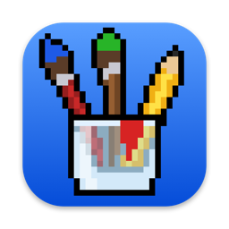
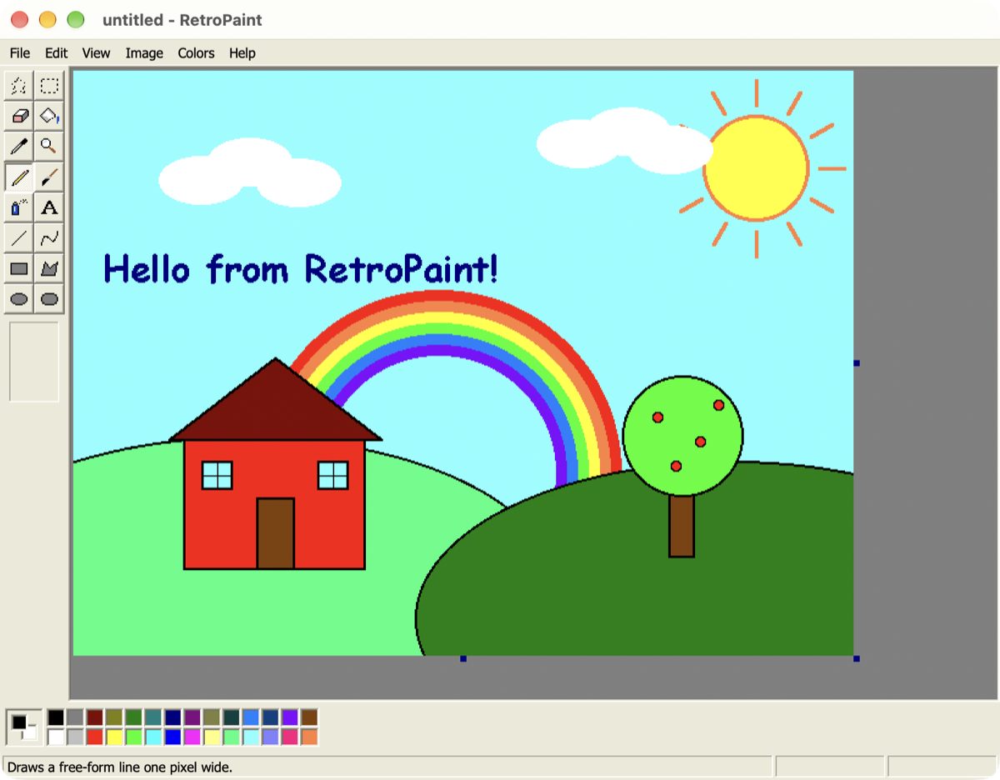
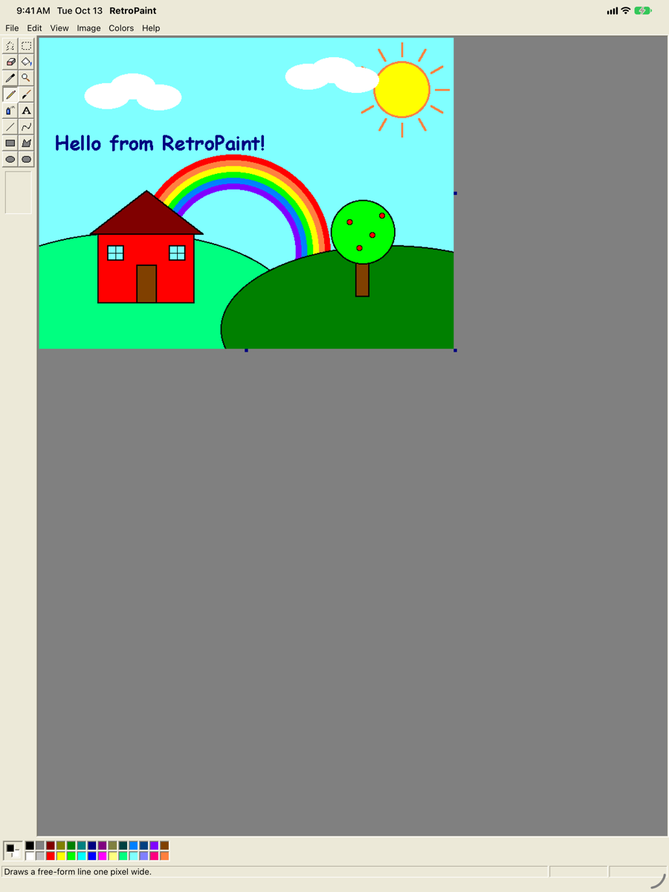
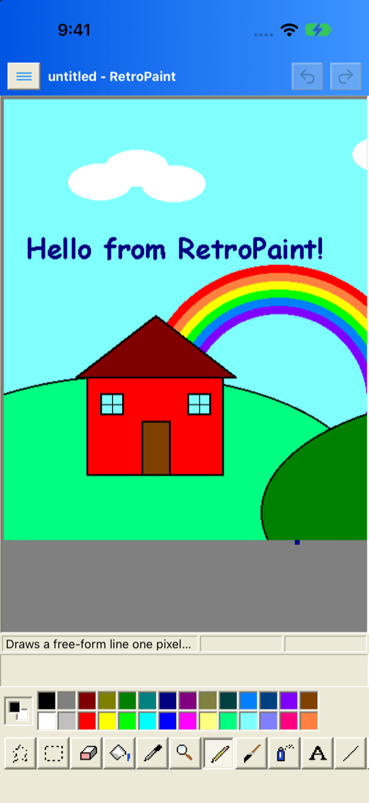

<p align="center">
  
</p>

<h1 align="center">RetroPaint</h1>

<p align="center">
  The classic early-2000s MS Paint, rebuilt from scratch as a native app for <b>Mac, iPad and iPhone</b>.<br>
  <a href="https://harkhowalia-1.github.io/RetroPaint/"><b>Website &amp; in-browser demo →</b></a>
</p>

<p align="center">
  <a href="https://github.com/harkhowalia-1/RetroPaint/releases/latest/download/RetroPaint-macOS.dmg"><b>⬇ Download for Mac (.dmg)</b></a>
  &nbsp;·&nbsp;
  <a href="https://github.com/harkhowalia-1/RetroPaint/releases/latest/download/RetroPaint-iOS.ipa"><b>⬇ Download for iPhone &amp; iPad (.ipa)</b></a>
</p>

<p align="center">
  
</p>

<p align="center">
  
  &nbsp;
  
</p>

## Features

- **All 16 classic tools** — free-form and rectangle select, eraser / color eraser, fill, pick color, magnifier, pencil, brush, airbrush, text, line, curve, rectangle, polygon, ellipse and rounded rectangle, each with its classic options.
- **The 28-color palette** — left click for foreground, right click (long-press on touch) for background, double-click to define a custom color.
- **Type directly on the canvas** — drag a text box, then move and resize it by its border and 8 handles, with a floating Fonts toolbar.
- **Image menu** — Flip/Rotate, Stretch/Skew, Invert Colors, Attributes and Clear Image, on the whole picture or the current selection.
- **Pixel-perfect** — every primitive is aliased and drawn on whole pixels; zoom to 800% with a grid and thumbnail.
- **Real files** — open and save PNG, BMP, JPEG, GIF and TIFF; clipboard, print and share.
- **One codebase, three devices** — SwiftUI with a shared drawing engine. Mac and iPad use the classic window layout; iPhone re-flows it for one hand.
- **Classic chrome** — beveled buttons, Luna-style title bars with close boxes, and classic message boxes.

## Download

| Platform | File | Notes |
| --- | --- | --- |
| Mac | [RetroPaint-macOS.dmg](https://github.com/harkhowalia-1/RetroPaint/releases/latest/download/RetroPaint-macOS.dmg) | macOS 14+, Apple silicon and Intel. Open the DMG and drag RetroPaint to Applications. The app isn't notarized yet, so on first launch right-click it and choose **Open** (or allow it in System Settings → Privacy & Security). |
| iPhone & iPad | [RetroPaint-iOS.ipa](https://github.com/harkhowalia-1/RetroPaint/releases/latest/download/RetroPaint-iOS.ipa) | iOS 17+. Unsigned — install with [AltStore](https://altstore.io) or [Sideloadly](https://sideloadly.io), which sign it with your Apple ID. |

All builds are on the [Releases page](https://github.com/harkhowalia-1/RetroPaint/releases).

## Build from source

Requires a recent Xcode and [XcodeGen](https://github.com/yonaskolb/XcodeGen).

```bash
git clone https://github.com/harkhowalia-1/RetroPaint.git
cd RetroPaint
brew install xcodegen
xcodegen generate
open RetroPaint.xcodeproj
```

Choose the **RetroPaint** scheme, pick *My Mac*, an iPad or an iPhone simulator, and run. Deployment targets are macOS 14 and iOS 17. To run on a physical device, select your Apple developer team under *Signing & Capabilities*.

## Project layout

| Path | What's there |
| --- | --- |
| `Sources/Engine` | `Bitmap` (pixel buffer and drawing primitives), `TextLayout`, tools, and `PaintDocument` (all editing logic and undo) |
| `Sources/Canvas` | The canvas renderer plus native `NSView` / `UIScrollView` hosts for mouse, touch, Pencil and keyboard |
| `Sources/UI` | Toolbox, color box, menus, dialogs, Fonts toolbar and the pixel-art tool icons |
| `Sources/App` | App entry point and the Mac/iPad and iPhone layouts |
| `Tools/` | Scripts that draw the app icon and the website assets with the app's own engine |
| `docs/` | The website (GitHub Pages), including a small in-browser version of the editor |

## License

RetroPaint is released under the [MIT License](LICENSE).

## Disclaimer

RetroPaint is an independent, from-scratch project inspired by the bitmap editors of the early 2000s. It contains no code or artwork from any other product and is not affiliated with or endorsed by Microsoft. Windows and Paint are trademarks of Microsoft Corporation.

## Support

If you enjoy this project, you can support me here:

<a href="https://buymeacoffee.com/harkhowalia"></a>
